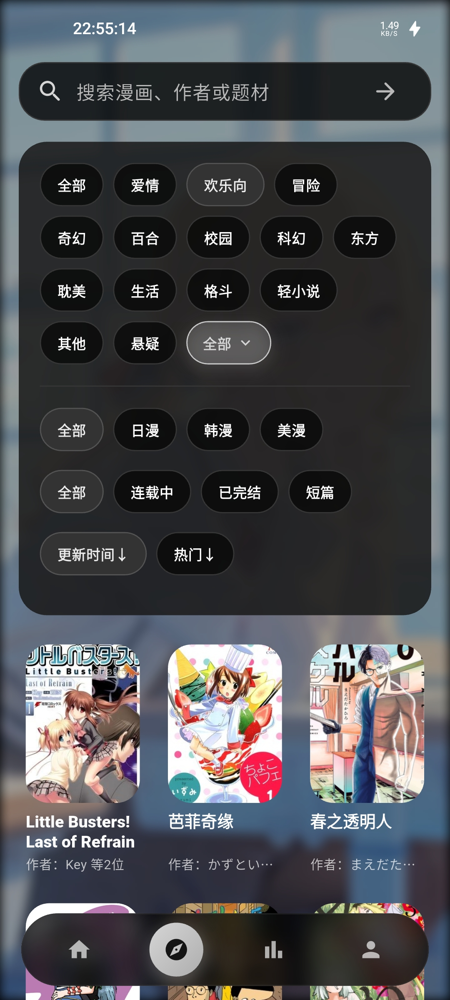
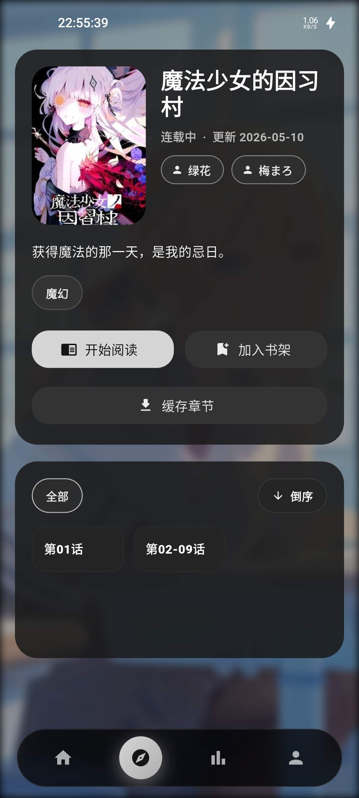
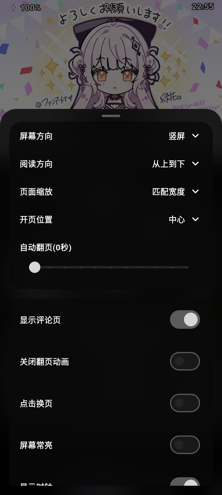
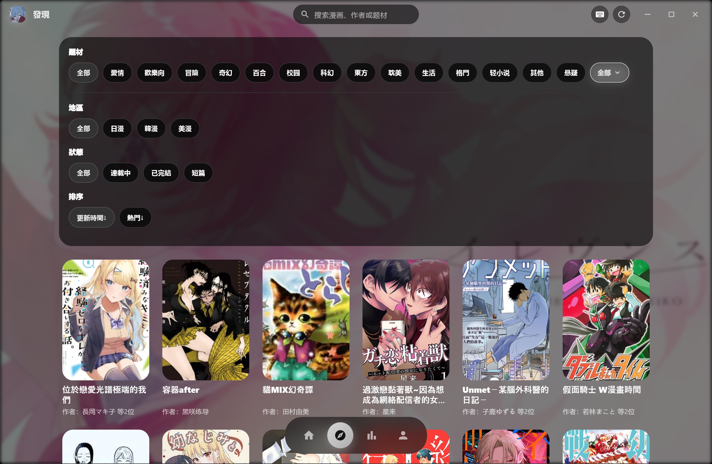
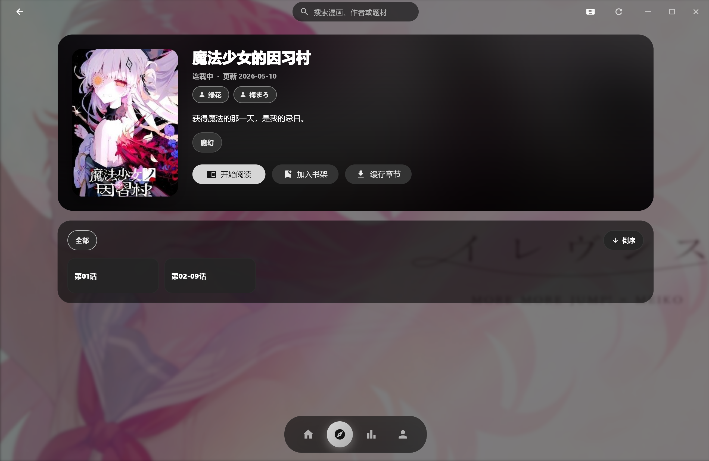

<div align="center">


# EasyCopy

<p>
  <a href="https://github.com/huangusaki/EasyCopy/releases/latest"></a>
  
  <a href="https://github.com/huangusaki/EasyCopy/releases"></a>
</p>

</div>

---

基于 Flutter 开发的第三方漫画客户端，采用后台 WebView 抓取数据 + 原生 UI 渲染的方案，支持 **Android** 和 **Windows**。

## 截图预览

### Android

<div align="center">

<table>
  <tr>
    <td align="center"><strong>发现筛选</strong></td>
    <td align="center"><strong>作品详情</strong></td>
  </tr>
  <tr>
    <td align="center"></td>
    <td align="center"></td>
  </tr>
  <tr>
    <td align="center"><strong>阅读页 & 评论</strong></td>
    <td align="center"><strong>阅读设置</strong></td>
  </tr>
  <tr>
    <td align="center"></td>
    <td align="center"></td>
  </tr>
</table>

</div>

### 平板书本阅读

<div align="center">


</div>

### Windows

<div align="center">

<table>
  <tr>
    <td align="center"><strong>发现筛选</strong></td>
    <td align="center"><strong>设置</strong></td>
  </tr>
  <tr>
    <td align="center"></td>
    <td align="center"></td>
  </tr>
</table>

</div>

## 功能特性

- **阅读**：支持条漫/翻页模式、双指缩放、音量键翻页、自动记录阅读进度。
- **浏览**：分类筛选、排行榜、全局搜索、本地书架管理。
- **缓存**：支持漫画离线下载、断点续传、自定义及迁移缓存目录。
- **网络**：支持节点测速与自动切换，提供原生登录与网页登录两种方式。
- **界面**：多套主题配色，支持深浅色模式跟随系统及 Material You 动态取色。
- **桌面端**：针对 Windows 端适配了宽屏布局、快捷键操作与全屏阅读。

## 下载安装

前往 [**Releases**](https://github.com/huangusaki/EasyCopy/releases/latest) 页面下载最新版本：

| 平台 | 文件 | 说明 |
| --- | --- | --- |
| Android | `*-android-<abi>.apk` | 主流设备请下载 `arm64-v8a` 版本 |
| Windows | `*-windows-x64.zip` | 绿色版，解压后直接运行 exe |
| iOS | `*-ios-unsigned.ipa` | **实验性构建**：未签名且未经完整测试，需自签安装 |

> **注意**：Windows 端的网页登录功能依赖 **WebView2 Runtime**（Win11 已内置；Win10 若缺失，启动时会提示安装）。

## 编译构建

确保本地已配置好 Flutter 环境（要求 Dart 3.9+，Android 端需 Java 17）：

```bash
# 获取依赖
flutter pub get

# 调试运行
flutter run -d android
flutter run -d windows

# 构建发布包
flutter build apk --release --split-per-abi
flutter build windows --release
```

## 许可证与声明

本项目基于 [GPL-3.0](../LICENSE) 协议开源。第三方依赖及 OpenCC 字典的相关声明见 [NOTICE](../NOTICE)。

**免责声明**：本项目仅为第三方客户端，与任何漫画站点无关，不提供也不存储任何漫画内容。请支持正版。

---

<div align="center">
  <sub>Built by <a href="https://github.com/huangusaki">Huangusaki</a></sub>
</div>
